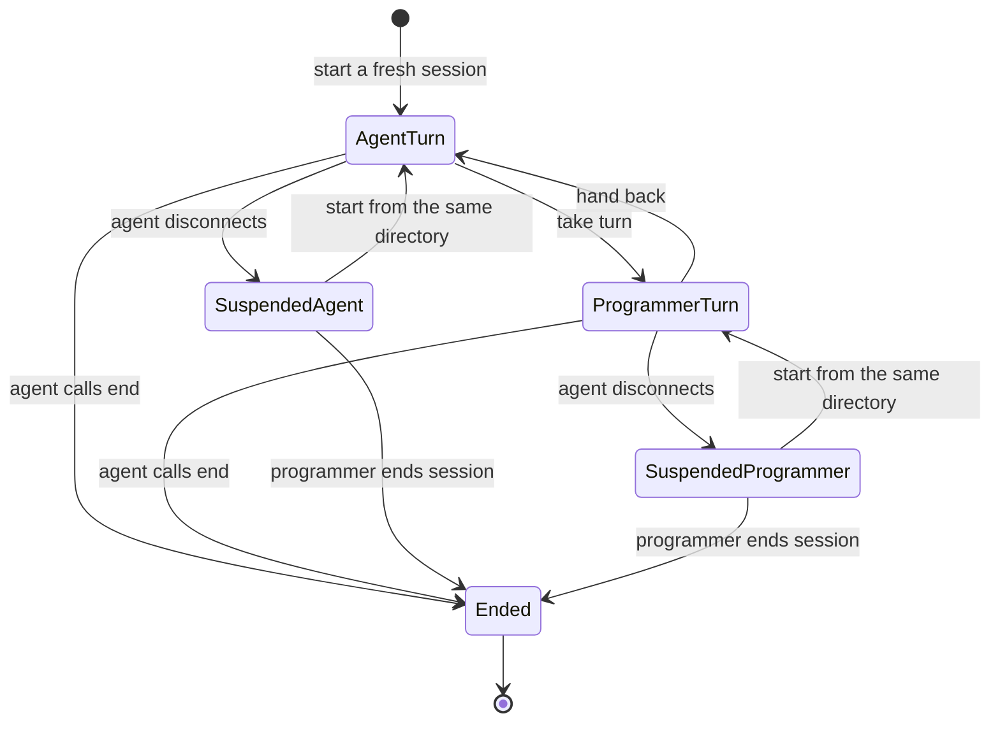
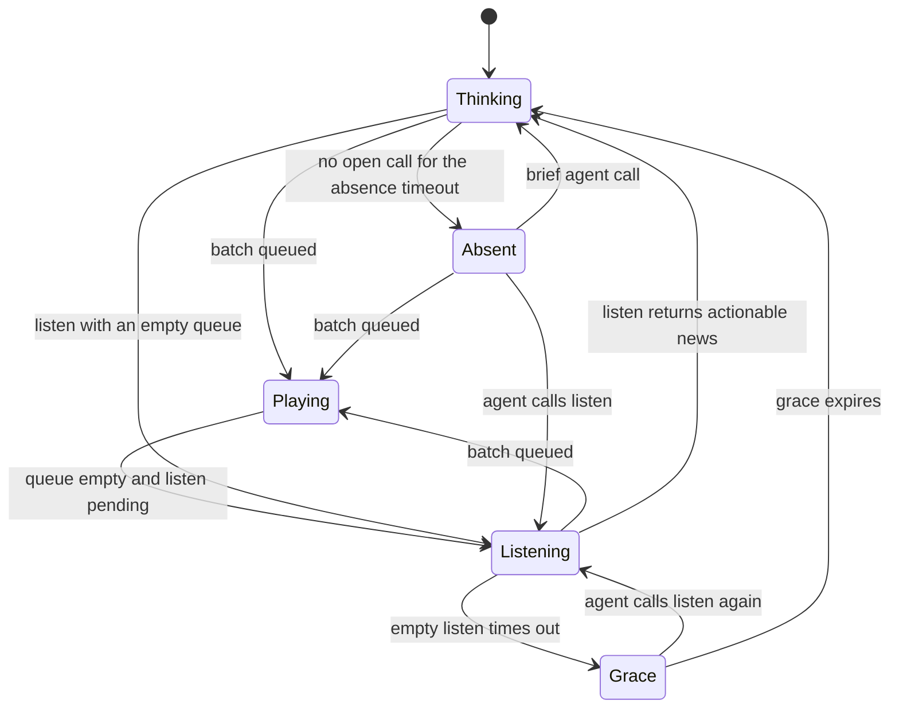

# Pair turn and status flow

The core controller owns the session's turn, queue, pause reasons and
connection state. The panel displays a projection of that state. These graphs
describe the current implementation; proposed changes are identified below.

## Session and turn ownership

The controller stores ownership in `session.scene.turn`. Listening, a reply,
an interruption and a pause do not by themselves hand over the turn. A
disconnect suspends the session and preserves its turn; queued work is
interrupted and discarded. Starting from a different directory replaces the
suspended session with a fresh one. A window reload can also restore a saved
session as suspended.

A natural pause or completed task is a time for the agent to send a short
summary through a Pair `say` action and call `listen`. The agent is instructed
to call `end` only when the programmer explicitly asks to end the session.
This guidance is not enforced by the runtime: it accepts an `end` call without
checking the programmer's intent. A one-shot agent's final answer can end that
agent process; client shutdown then closes the relay's stdin. Losing the editor
connection suspends Pair without proving that either process exited.

## Activity while the agent has the turn

`Grace` is an internal interval displayed as listening. With production
defaults, an empty `listen` can time out after 45 seconds, and an empty result
keeps the listening display for up to 10 more seconds. If no call is open for
45 seconds, the status becomes absent. A completed batch without a command
does not wake a pending `listen`; it can remain pending until its timeout. A
completed command does wake it. See [ListenGrace.tla](/specs/ListenGrace.tla)
and the controller's `NoQuietWake` tests.

## What the panel says

| Condition | Panel status | Meaning |
| --- | --- | --- |
| Agent listening with an empty queue | Your move | The agent is listening; the programmer may reply. The agent still owns the turn. |
| Programmer owns the turn | Your turn | The programmer can edit while the agent navigates. |
| Agent has no pending work and is not listening | Waiting for agent | The agent owns the turn. |
| No open agent call for the absence timeout | Agent isn't listening | The agent has not made a call recently. |
| Playback is paused | Paused | One or more pause reasons apply; ownership is unchanged. |
| Command needs approval | Needs you | The command is awaiting a decision. |
| Agent disconnects | Suspended: waiting for the agent | The session waits for reconnection or for the programmer to end it. |

The panel also shows playback states such as Playing, Read this, Running a
command and Speaking. Pause reasons include an explicit pause, a reply being
written, and looking away from the followed editor. An editor or viewport
change can cause the last reason without physical keyboard or mouse input.

## Assessment and proposed follow-up

The controller is the authoritative owner of turn and pause state; the panel
and companion mirror or project it. The label `Your move` can appear just
because the agent called `listen`, without a turn change or an obligation to
reply. A clearer proposed label is `Listening - you can reply`; retain `Your
turn` for programmer ownership.

If presentation edge cases need a larger change, consider a single
core-derived presentation snapshot containing lifecycle, owner, activity,
pause reasons and any explicit wait reason, scoped to the session. A required
reply should have a typed reason rather than being inferred from message text.
This is a proposal, not the current architecture.
